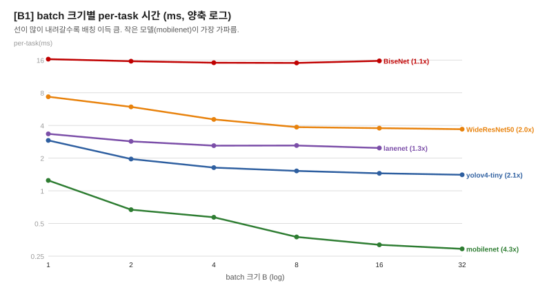
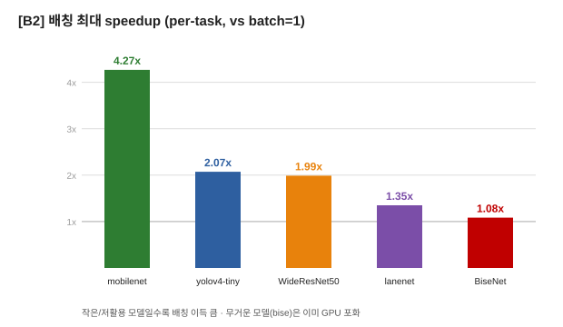
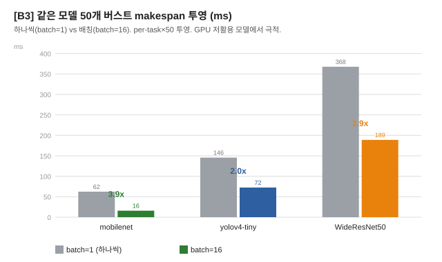

# 배칭(batching) — 추가 작업 & 실험 결과

> 환경: RTX 3060 Laptop(6GB, OpenCL) + i5-11400H(6C) / TFLite fp32
> 도구: `split_profiler/batch_test.cc` (신규)

---

## 1. 무엇을 추가했나

### 배칭이란
같은 모델의 입력 여러 개를 **batch 차원으로 쌓아** Invoke를 한 번만 호출하는 것.
```
기존:  Invoke(입력1) → Invoke(입력2) → ... → Invoke(입력N)   (N번, 하나씩)
배칭:  입력 shape [1,H,W,C] → [B,H,W,C] 로 묶어 Invoke 1번에 B개
```

### 왜 빠른가 (지금까지의 레버와 다른 축)
- 작은 모델 하나(batch=1)는 **GPU 코어의 10%도 못 씀** → 90%가 놀고 있음.
- B개를 묶으면 그 노는 코어가 동시에 B개 처리 → 거의 같은 시간에 B배 일.
- **지금까지(배정/스케줄링)**: task를 *어디서* 돌릴까 (CPU/GPU).
- **배칭**: GPU에 *몇 개씩 묶어* 보낼까 → **ALL-GPU 기준선 자체를 끌어내림.**

### 추가한 코드
- **`batch_test.cc`** (신규): 모델 입력을 `ResizeInputTensor([B,...])`로 batch 차원 교체 →
  GPU delegate 적용 → B ∈ {1,2,4,8,16,32} 별 per-Invoke 시간 측정 → per-task(=total/B) 보고.
  배치 미지원(리사이즈/할당/Invoke 실패) 모델은 "미지원"으로 표기.
- 생성 그림: `fig_batching.py` → `docs/figures/figB1~B3.svg`

---

## 2. 실험: 5개 모델 batch 스윕 (측정)

`batch_test <5 models> --runs 8` 결과 (per-task ms):

| model | B=1 | B=2 | B=4 | B=8 | B=16 | B=32 | 최대 speedup |
|---|---|---|---|---|---|---|---|
| **mobilenet** | 1.246 | 0.670 | 0.571 | 0.376 | 0.318 | **0.292** | **4.26x** |
| yolov4-tiny | 2.912 | 1.964 | 1.635 | 1.525 | 1.450 | **1.406** | **2.07x** |
| WideResNet50 | 7.351 | 5.934 | 4.548 | 3.861 | 3.778 | **3.698** | **1.99x** |
| lanenet | 3.345 | 2.852 | 2.607 | 2.614 | **2.479** | (OOM) | **1.35x** |
| BiseNet | 16.32 | 15.64 | 15.14 | **15.07** | 15.73 | (OOM) | **1.08x** |




---

## 3. 버스트 makespan 투영 (같은 모델 50개)

per-task × N 투영 (batch=1 vs batch=16):

| 버스트 | batch=1 | batch=16 | 배속 |
|---|---|---|---|
| mobilenet ×50 | 62.3ms | 15.9ms | **3.9x** |
| yolov4 ×50 | 145.6ms | 72.5ms | **2.0x** |
| WideResNet ×50 | 367.6ms | 188.9ms | **1.9x** |



**비교**: 지금까지 CPU-offload(배정)는 1.00~1.12x였는데, **배칭은 같은 모델 버스트에서 2~4x** — 차원이 다른 이득.

---

## 4. 분석

### 어떤 모델이 이득 보나
- **큼 (저활용 모델)**: mobilenet 4.26x, yolov4 2.07x, WideResNet 1.99x
  → 단일 추론이 GPU를 못 채우던 모델일수록 배칭으로 채워 이득.
- **작음 (이미 포화)**: BiseNet 1.08x → 한 번 추론으로도 GPU를 거의 채워 여지 없음.
- lanenet 1.35x: 중간. B32는 VRAM 초과(OOM)로 실패(6GB 한계).

### sweet spot
- mobilenet/yolo/wide: **B=16 전후**에서 대부분의 이득을 얻고 그 뒤는 완만 (포화).
- 무거운 모델은 큰 B에서 **VRAM 초과(OOM)** → 메모리가 상한.

### 핵심 통찰
- 지금까지의 ALL-GPU 기준선(task 하나씩 직렬)은 **GPU를 저활용으로 낭비한 값**.
- 배칭은 그 **기준선 자체를 1/2~1/4로** 낮춤 → CPU offload와 독립적이고 훨씬 큰 레버.

---

## 5. 배칭 vs CPU offload — 역할 분담

| 상황 | 유리한 방식 |
|---|---|
| **같은 모델 버스트** (mob×50 등) | **배칭** (2~4x) |
| 혼합/무거운 모델 배치 | CPU offload (통합 플래너, 1.0~1.12x) |

- 배칭으로 GPU가 빨라질수록 CPU로 offload할 이유는 줄어듦 → 같은 모델 버스트는 "배칭된 all-GPU"가 최선.
- 둘은 **경쟁이 아니라 워크로드별 역할 분담**.

---

## 6. 통합 플래너 반영 (제안/다음 단계)

1. **캘리브레이션에 batched g_eff(B) 추가** → 모델별 sweet-spot B 선택
2. **GPU 레인에서 같은 모델 묶어 batched Invoke** (N → ceil(N/B)번)
3. **ALL-GPU 기준선도 배칭 버전**으로 (공정 비교)
→ 적용 시 mob×50이 ~55ms → ~16ms (3.4x) 로 떨어질 것으로 투영됨.

---

## 7. 한 줄 메시지

> **배칭 = GPU에 같은 모델 여러 개를 묶어 보내 저활용을 없애는 레버.**
> 작은 모델 버스트에서 2~4x (mobilenet 4.26x) — 배정/스케줄링(1.0~1.12x)과 다른 차원의 이득.
> 메모리(VRAM)가 상한, 무거운 모델은 이미 포화라 효과 작음.
