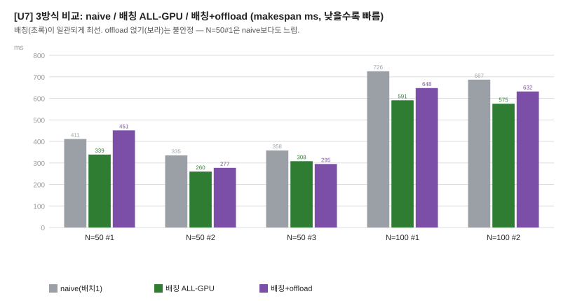

# 배칭 통합 실험 — 전체 결과 (PPT용)

> 환경: RTX 3060 Laptop(6GB, OpenCL) + i5-11400H(6C) / TFLite fp32 / cpu-cores=6, batch=16
> 도구: `unified.exe` (배정 + **배칭** + 캘리브레이션). 랜덤 혼합 5개 모델.

---

## 1. 추가된 것

- **배칭을 통합 플래너에 통합**: GPU 레인에서 같은 모델 task를 batch로 묶어 `ceil(N/B)`번 Invoke.
- **모델별 배치 결정**: 캘리브레이션에서 `batch per-task < 0.85 × batch1`일 때만 배칭,
  아니면 `batch=1` (무거운 모델은 이득 없고 **VRAM만 폭발** → 자동 제외).
- **3방식 동시 측정**: naive(배치1) / 배칭 ALL-GPU / 배칭+offload(UNIFIED).

---

## 2. 결과 (makespan ms, speedup vs naive)

| N | seed | naive | 배칭 ALL-GPU | 배칭+offload | **배칭** | offload까지 |
|---|---|---|---|---|---|---|
| 50 | 1 | 411 | 339 | 451 | **1.21x** | 0.91x ⚠️ |
| 50 | 2 | 335 | 260 | 277 | **1.29x** | 1.21x |
| 50 | 3 | 358 | 308 | 295 | 1.16x | **1.21x** |
| 100 | 1 | 726 | 591 | 648 | **1.23x** | 1.12x |
| 100 | 2 | 687 | 575 | 632 | **1.19x** | 1.09x |

---

## 3. 핵심 발견 — 두 레버는 겹치지 않는다 (배칭이 offload를 supersede)

- **배칭만(ALL-GPU batched)**: 일관되게 **1.16~1.29x** (혼합), 순수 버스트는 **4x** (mob×50).
- **배칭 + CPU offload**: **불안정** — 5개 중 4개에서 배칭만보다 나쁘고, N=50#1은 **0.91x**(naive보다도 손해).

**이유**:
- 배칭 없을 때 → GPU가 느린 병목 → CPU offload가 도움 (1.0~1.12x)
- 배칭 켜면 → GPU가 빨라져 **병목이 아님** → CPU offload는 (a) 느린 CPU + (b) **CPU 워커가 GPU 구동 코어를 뺏어** 역효과

→ **배칭할 수 있으면 "배칭 ALL-GPU"가 답. offload는 배치 불가(전부 다른 모델)일 때만 의미.**

---

## 4. VRAM 교훈 (수정 전/후)

- **수정 전**: 모든 모델을 batch=16으로 → N=100에서 무거운 모델 5개 배칭 인터프리터가 **6GB 초과 → thrashing → 0.06x 참사**.
- **수정 후**: 이득 보는 모델만 배칭, 무거운 모델 batch=1 → VRAM 안전 → **1.12x 복구**.
- 교훈: **배칭은 VRAM이 상한.** 무거운 모델은 이미 포화라 배칭 이득도 없어 자동 제외가 정답.

---

## 5. 최종 권장 정책

| 워크로드 | 최선 |
|---|---|
| 같은 모델 버스트 (mob×50 등) | **배칭 ALL-GPU** (최대 4x) |
| 랜덤 혼합 | **배칭 ALL-GPU** (1.16~1.29x) |
| 전부 다른 모델 (배치 불가) | CPU offload 라우팅 (1.0~1.12x) |

---

## 6. 한 줄 메시지

> **배칭이 이 시스템의 가장 큰 단일 레버**(혼합 1.2x, 버스트 4x)이고, GPU를 병목에서 빼내므로
> **CPU offload를 대체(supersede)** 한다. 통합 플래너는 배칭을 모델별로(이득+VRAM 고려) 적용하고,
> offload는 배치가 불가능한 경우로 역할이 좁아진다.
