# CPU/GPU 분할 스케줄러 — 시각화 리포트

> 환경: RTX 3060 Laptop GPU(6GB, OpenCL) + i5-11400H(6코어) / TFLite fp32
> 도구: `split_profiler`(오프라인 분할 측정) → `jackson_online`(온라인 Jackson 스케줄러)
> 그림은 의존성 없이 순수 Python으로 생성한 SVG (`split_profiler/generate_figs.py`).

---

## 1. 모델별 절단 지점 (어디서 CPU/GPU로 잘랐나)

각 모델을 두 방향으로 1컷 분할했을 때의 **균형 절단 지점**. 파랑=CPU 노드, 빨강=GPU 노드, 검은 선 `|`=cut.

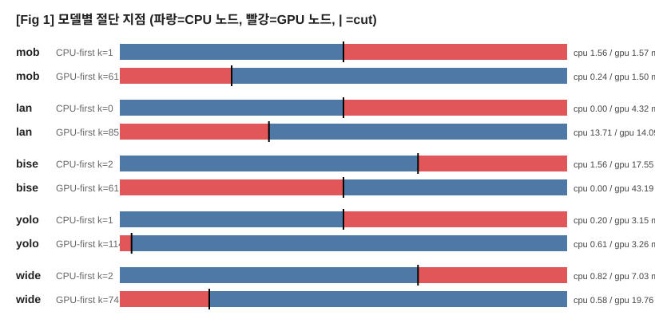

- 대부분 **GPU 쪽이 크다** — CPU가 4~100배 느려서 균형 cut이 "CPU엔 아주 조금만"으로 잡힘.
- 예외적으로 mobilenet(CPU-first k=1)은 앞 노드 하나만 CPU여도 stage가 얼추 맞음(1.56 vs 1.57).
- BiseNet GPU-first는 거의 전부 GPU(cpu 0.00) — 사실상 통짜 GPU.

---

## 2. 방향별 stage 시간 (CPU-stage / GPU-stage)

각 모델×방향의 두 스테이지 실측 시간(ms). 파랑=CPU-stage, 빨강=GPU-stage. 이 값들이 Jackson 스케줄러의 입력(p1, p2).

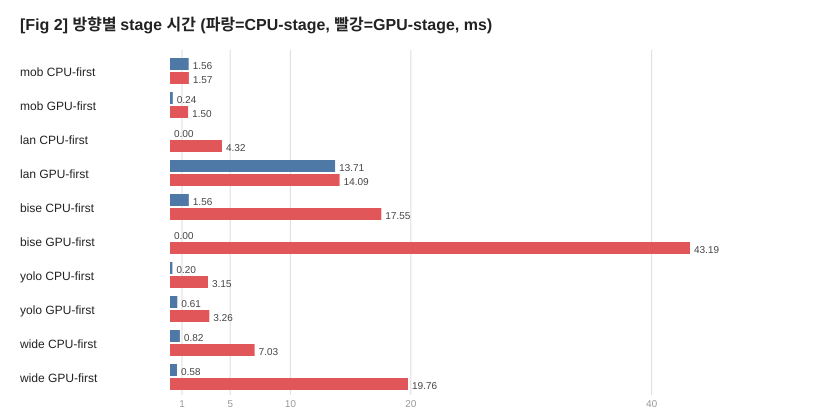

- GPU-stage가 대체로 CPU-stage보다 크거나, CPU-stage가 0에 가까움 → **CPU가 맡는 몫이 작다.**
- BiseNet GPU-first의 gpu_stage 43ms가 최대 — 무거운 모델은 GPU에 통째로 쏠림.

---

## 3. 30-task 스케줄 순서 (Jackson 예측 타임라인)

30개(mob7 yolo7 lan6 bise5 wide5)를 Jackson 순서로 배열한 **예측 스케줄**. 위=CPU 레인, 아래=GPU 레인, 색=모델.

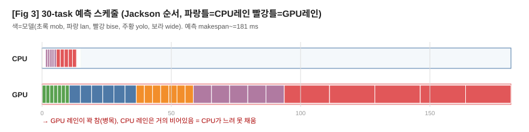

- **GPU 레인이 꽉 참(병목), CPU 레인은 거의 비어있음.** → CPU가 느려 못 채우니 겹침이 거의 없음.
- makespan ≈ 전체 GPU 작업량. 스케줄링을 아무리 잘 해도 GPU 총량이 바닥선.
- (이 그림은 stage 시간 기반 *이상적* Jackson 예측. 실제 실행은 아래 5번처럼 컨텍스트 문제로 달랐다.)

---

## 4. 워크로드별 speedup (실측, vs ALL-GPU)

`jackson_online` 실측. 1.0 위=이득(초록), 아래=손해(빨강).

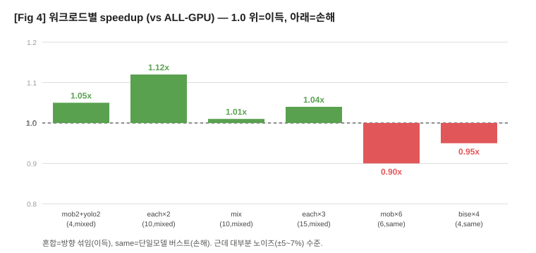

- **혼합 워크로드(방향 섞임)**: 1.01~1.12x — 소폭 이득. 방향이 섞여 CPU/GPU 겹침이 생김.
- **단일 모델 버스트(방향 하나로 쏠림)**: 0.90~0.95x — 손해. 겹침 없이 경계비용만.
- 다만 대부분 **측정 노이즈(±5~7%) 수준**. 확실한 이득은 each×2(1.12x)뿐.

---

## 5. 30-task 비효율 (예측 vs 실측, 로그축)

30개를 실제로 돌렸을 때 — **예측 대비 ~2000배 느림.**

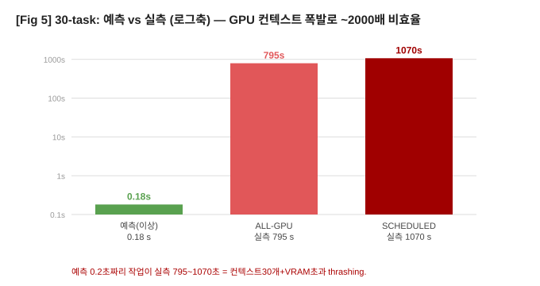

- 예측 이상 스케줄은 1초 미만인데, **실측은 ALL-GPU 795초 / SCHEDULED 1070초.**
- 원인: **인스턴스마다 GPU 인터프리터 1개 = CL 컨텍스트 30개** + WideResNet×5 가중치 → **VRAM 6GB 초과 → 페이징/컨텍스트 thrashing.** (연산이 아니라 메모리 관리에 시간 낭비)
- **아키텍처 스케일 한계**: "인스턴스당 인터프리터 1개"는 ~15~20개까지만. 그 이상은 **동시 GPU 인터프리터 수 상한(세마포어)** 또는 **배칭**이 필요.

---

## 6. 통짜 라우팅(multitask) vs split(jackson) 비교

같은 워크로드를 **통짜 라우팅**(task를 안 쪼개고 통째로 CPU 또는 GPU)과 **split 파이프라인**(1컷 분할)으로 각각 실측한 speedup.

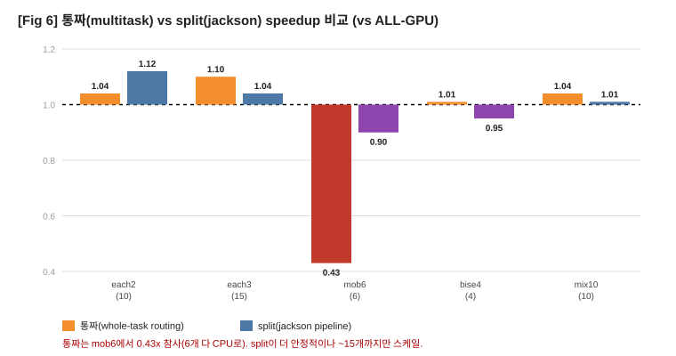

- **통짜는 mob6에서 0.43x 참사** — mobilenet 6개를 전부 CPU로 몰아서(GPU면 8.94ms인데 CPU로 20.9ms). 비용표 오차가 부른 잘못된 배분.
- **split은 더 안정적**(0.90~1.12x)이나 **~15개까지만** 스케일(컨텍스트 폭발).
- 둘 다 이득은 대체로 노이즈 수준. 통짜가 참사 위험이 더 큼.

## 7. 50-task 통짜 라우팅 (실측)

통짜 라우팅은 GPU 인터프리터를 **모델당 1개(공유)** 로 써서 **50개도 컨텍스트 폭발 없이 정상 실행**됨 (split과 대조).

**배분** (GPU=32, CPU=18):

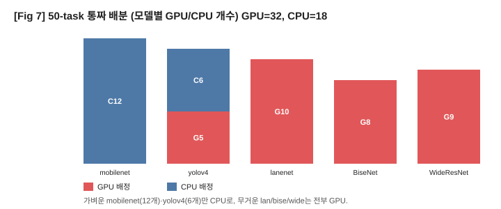

**makespan 실측** (로그축):

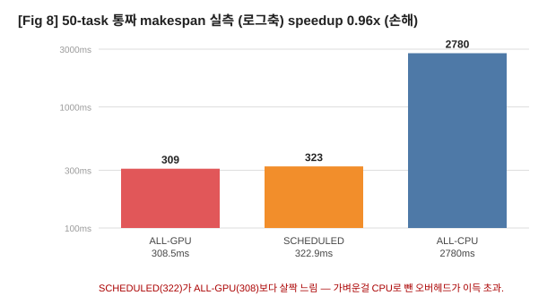

- 가벼운 mobilenet(12)·yolov4(6)만 CPU로, 무거운 lan/bise/wide는 전부 GPU.
- ALL-GPU 308ms / ALL-CPU 2780ms / SCHEDULED 322ms → **0.96x (소폭 손해)**.
- 가벼운 것 CPU로 뺀 오버헤드가 GPU 절감을 초과 → 통짜여도 이득 없음.

---

## 8. task 수(N) 늘리면 이득이 커지나? (통짜, N=50~120)

"task가 많아지면 GPU 몰림 대신 CPU가 일부 맡아 이득 아닐까?"를 실측. 랜덤 혼합으로 N=50/70/90/100/120.

| N | ALL-GPU | SCHEDULED | speedup |
|---|---|---|---|
| 50 | 532.9 | 497.3 | **1.07x** |
| 70 | 828.4 | 811.0 | 1.02x |
| 90 | 1053.0 | 1053.0 | 1.00x |
| 100 | 1128.4 | 1217.6 | 0.93x |
| 120 | 1329.3 | 1549.3 | **0.86x** |

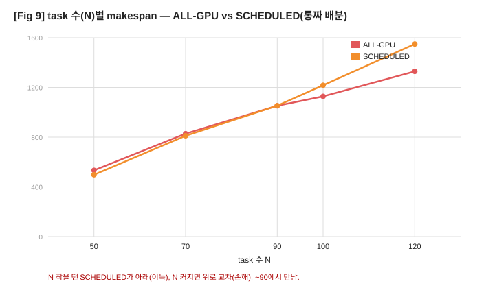

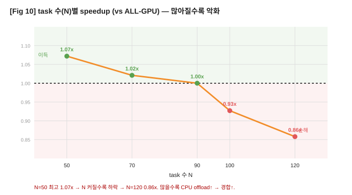

- **직관과 반대**: 많아질수록 이득이 커지는 게 아니라 **줄다가 손해로 뒤집힘** (대략 1.0x 근처에서 요동, N 클수록 손해 쪽).
- (측정 노이즈 큼 — 같은 N도 run마다 열/터보로 편차. 절대값보다 아래 GPU측/CPU측 분해가 원인을 정확히 보여줌.)

### 왜 손해? — GPU 경합이 아니라 **CPU측 과부하** (GPU측/CPU측 분해)

makespan = **max(GPU측 완료, CPU측 완료)**. 두 쪽을 따로 재보면:

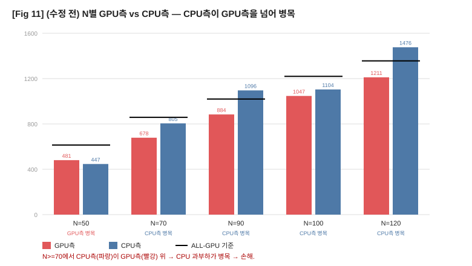

| N | GPU측 | CPU측 | ALL-GPU | 병목 |
|---|---|---|---|---|
| 50 | 480 | 447 | 614 | GPU측 → 이득 |
| 70 | 678 | 805 | 858 | CPU측 |
| 90 | 884 | 1096 | 1019 | CPU측 → 손해 |
| 120 | 1211 | 1476 | 1356 | CPU측 → 손해 |

- **GPU측은 offload할수록 오히려 줄어든다**(480→1211, task를 뺐으니) → **GPU 경합이 원인이 아님.**
- **CPU측이 병목**: N↑ → 스케줄러가 CPU로 과잉 오프로딩(N=120은 49개, 비싼 yolov4 C=249ms까지) → CPU측이 부풀어 ALL-GPU를 넘음.
- 과잉 오프로딩 이유: 비용표가 **1스레드 isolated C**라 경합을 안 잡음 → "CPU 여유 있다" 착각 → 실제 CPU측은 예측보다 ~1.5배 느림.
- 즉 **손해의 정체 = CPU측 과부하(잘못된 배분 + CPU 동시실행 경합)**, GPU 병목/경합 아님.

### 수정: "CPU측이 GPU측 넘으면 offload 취소" → 손해 소멸

배분 규칙을 **"CPU에 싼 것부터 offload하되, CPU측 예측이 GPU측을 넘으면 그 offload 취소·중단"** 으로 바꾸고, CPU 경합 보정계수 α=1.5를 예측에 반영.

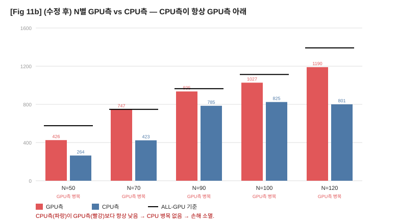

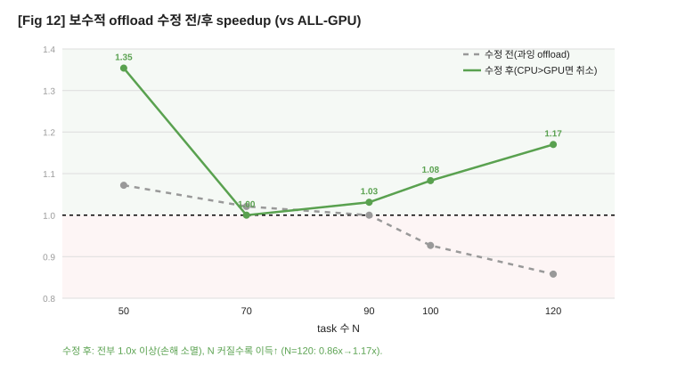

**makespan 관점 (fig9와 같은 형식, 수정 후):**

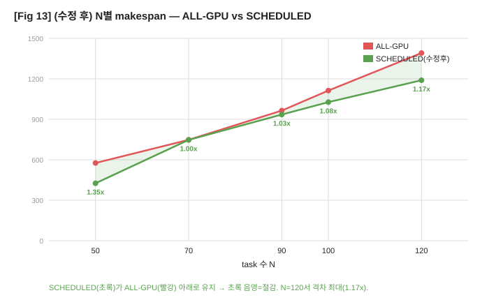

| N | 수정 전 | 수정 후 | GPU측 | CPU측 |
|---|---|---|---|---|
| 50 | 1.07x | **1.35x** | 426 | 264 |
| 70 | 1.02x | 1.00x | 747 | 423 |
| 90 | 1.00x | 1.03x | 935 | 785 |
| 100 | 0.93x | 1.08x | 1027 | 825 |
| 120 | **0.86x** | **1.17x** | 1190 | 801 |

- **CPU측이 항상 GPU측 아래로 유지됨** → CPU가 병목이 안 되니 makespan=GPU측≤ALL-GPU.
- **손해 완전 소멸**(전부 ≥1.0x), N=120은 0.86x → **1.17x** 대반전.
- **이제 N 커질수록 이득 증가** — "task 많으면 이득" 직관이 (제대로 된 배분으로) 실제 성립.

| 관점 | 결론 |
|---|---|
| 분할 지점 (Fig 1,2) | CPU 느려서 균형 cut이 GPU 쪽으로 치우침 → CPU 몫이 작음 |
| 스케줄 구조 (Fig 3) | Jackson 순서는 맞게 작동하나 CPU 레인이 비어 겹침이 적음 |
| split 성능 (Fig 4) | 혼합 1.01~1.12x(노이즈~소폭이득), 단일모델 0.90~0.95x(손해) |
| split 스케일 (Fig 5) | ~15개까지 정상, 30개는 GPU 컨텍스트 폭발로 무효 |
| 통짜 vs split (Fig 6) | split이 더 안정적(참사 없음), 통짜는 mob6서 0.43x. 둘 다 이득 작음 |
| 통짜 스케일 (Fig 7,8) | 통짜는 모델당 GPU 컨텍스트 1개라 50~120개도 정상 실행 |
| N 스케일링 (Fig 9,10) | **많아질수록 이득 감소→손해**: N=50 1.07x → N=120 0.86x (경합↑) |

**핵심**: 두 방식 모두 fp32 + discrete GPU에선 이득이 노이즈~소폭(최대 1.12x)이고 손해도 잦다 — CPU가 4~100배 느린 근본 한계(`1+1/R`). **통짜는 스케일되지만 잘못된 배분 시 참사(0.43x) 위험**, **split은 안정적이나 인스턴스당 GPU 컨텍스트라 ~15개까지만**. 그리고 **task를 더 늘려도 이득은 안 커지고 오히려 경합으로 손해**가 된다(Fig 10). 진짜 이득을 보려면 CPU 경쟁력(양자화) + 경합 억제(코어 예약·오프로딩 상한)가 전제.

**핵심**: 스케줄러 로직(방향 섞기 + Jackson)은 설계대로 작동하지만, **fp32에서 CPU가 너무 느려 이득이 작고**, **인스턴스당 GPU 컨텍스트 구조가 많은 task에서 스케일 안 됨.** 개선 방향: (1) CPU 경쟁력(양자화)로 CPU 레인 채우기, (2) 동시 GPU 컨텍스트 상한/배칭으로 스케일 확보.
