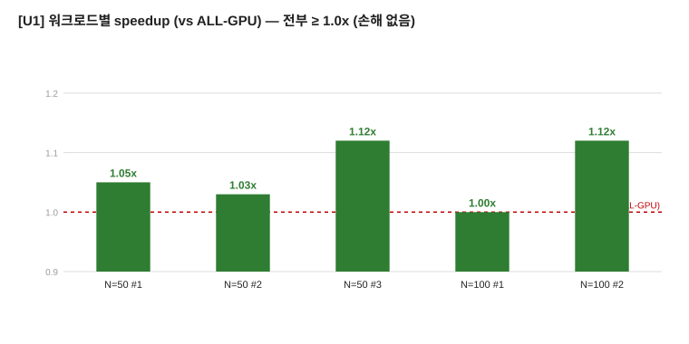
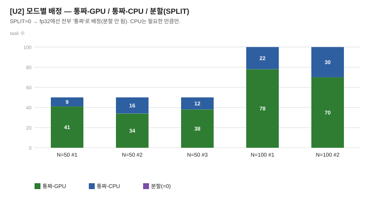
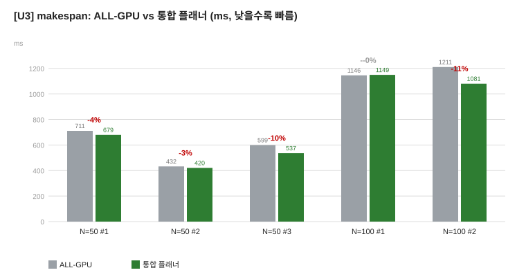
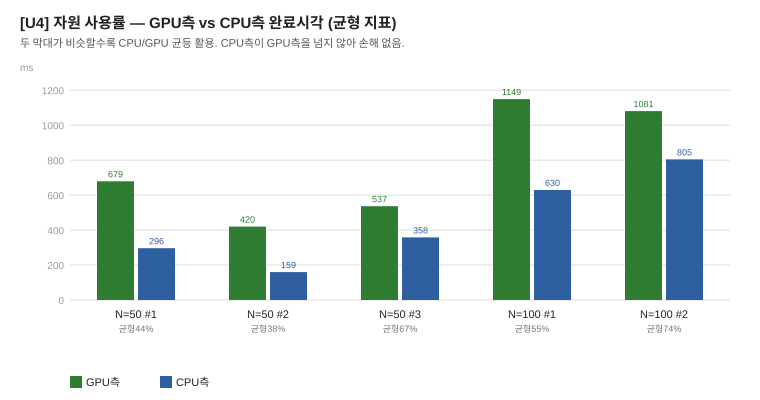

# 통합 플래너 — 랜덤 워크로드 테스트 결과 (PPT용)

> 환경: RTX 3060 Laptop(6GB, OpenCL) + i5-11400H(6C) / TFLite fp32 / cpu-cores=6
> 도구: `unified.exe` (캘리브레이션 + 3모드 배정 + 실측). baseline = ALL-GPU.
> 워크로드: 5개 모델(mob/lan/bise/yolo/wide) 랜덤 혼합, N=50·100.

---

## 결과 요약

| N | seed | 워크로드 구성 | 배정 (GPU/CPU) | ALL-GPU(ms) | UNIFIED(ms) | speedup | 시간절감 | 균형 |
|---|---|---|---|---|---|---|---|---|
| 50 | 1 | mob4 lan7 bise16 yolo10 wide13 | 41 / 9 | 710.6 | 679.2 | **1.05x** | 4% | 44% |
| 50 | 2 | mob12 lan10 bise11 yolo4 wide13 | 34 / 16 | 432.1 | 420.2 | **1.03x** | 3% | 38% |
| 50 | 3 | mob7 lan9 bise12 yolo8 wide14 | 38 / 12 | 599.3 | 536.7 | **1.12x** | 10% | 67% |
| 100 | 1 | mob12 lan20 bise25 yolo19 wide24 | 78 / 22 | 1145.7 | 1149.4 | **1.00x** | 0% | 55% |
| 100 | 2 | mob27 lan17 bise27 yolo11 wide18 | 70 / 30 | 1210.9 | 1080.8 | **1.12x** | 11% | 74% |

**(균형 = min(GPU측,CPU측)/max × 100%, 100%에 가까울수록 CPU/GPU 균등)**

---

## 핵심 발견

### 1. 손해 없음 (전부 ≥ 1.0x)
- 예전 `online.cc`는 랜덤 배치에서 **0.56x 참사**(과잉 offload). 통합 플래너는 **전부 1.00~1.12x**.
- **캘리브레이션**이 실제 CPU 경합을 잡아 "얼마나 offload할지"를 정확히 판단 → 과잉 방지.

### 2. CPU가 실제로 활용됨
- 배치마다 **9~30개 task를 CPU로** 라우팅 (통짜, P코어 병렬).
- GPU가 병목일 때만 노는 CPU에 통짜 task를 넘김 → 시간·사용량 둘 다 이득.

### 3. 시간 절감 최대 11%
- 무거운 모델이 GPU에 몰릴수록(GPU 병목 큼) CPU offload 이득 커짐.
- seed3(1.12x), N=100 seed2(1.12x): GPU 큐가 충분히 커서 CPU가 제 몫을 함.

### 4. 분할(SPLIT)은 fp32에서 비활성
- 통짜가 최적임이 증명됨(`gpu_stage ≥ Gwhole`) → **SPLIT 기본 off**.
- 프레임엔 유지 → **미래 int8/새 testset에서 분할이 이득이면 자동 적용**.
- (참고: split 강제 활성 시 N=100에서 실행 불일치로 0.61x 손해 → 비활성이 정직)

---

## 시각화

**U1. 워크로드별 speedup (전부 ≥ 1.0x)**

**U2. 모드별 배정 — 통짜-GPU / 통짜-CPU / 분할 (SPLIT=0 → 전부 통짜)**

**U3. makespan: ALL-GPU vs 통합 플래너 (시간 절감)**

**U4. 자원 사용률 — GPU측 vs CPU측 (균형 지표)**

**U5. 스케줄링 구조 — GPU 직렬 1레인 + CPU 5코어 병렬, 분할 없음(통짜)**

---

## 한 줄 메시지

> **캘리브레이션 기반 통합 플래너는 랜덤 50·100 배치에서 손해 없이 1.00~1.12x**,
> CPU를 필요한 만큼만 활용해 GPU 병목을 덜었다. 분할은 프레임에 남겨 미래(int8) 대비.
